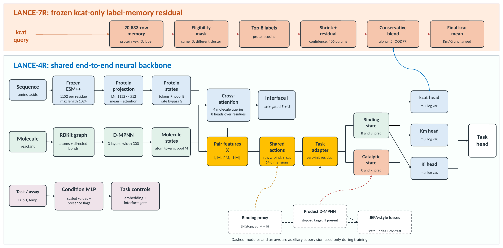
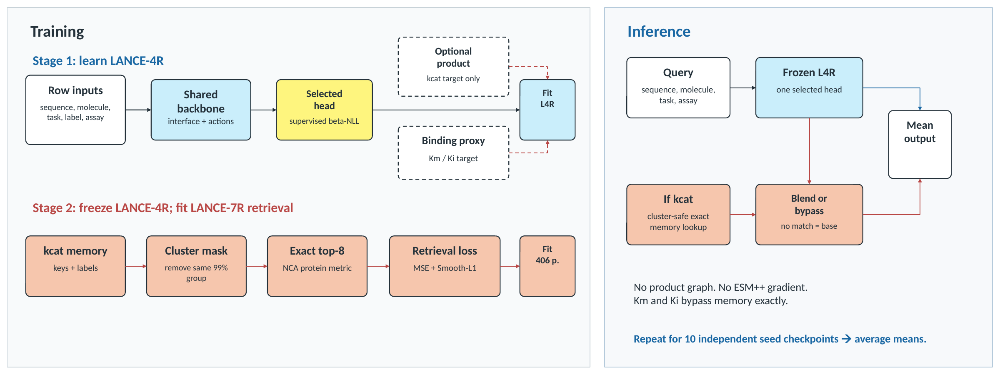
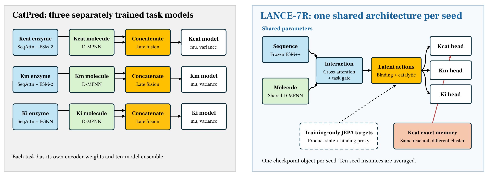
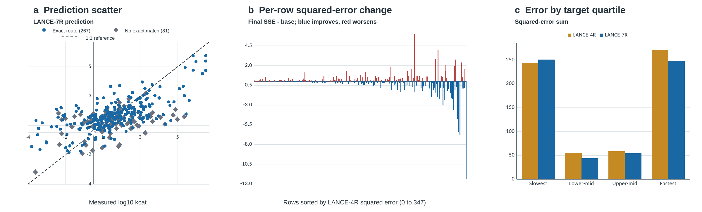

- LANCE is my research project on multitask enzyme-kinetics prediction, developed at the University of Maryland’s Laboratory of Molecular and Thermodynamic Modeling.
- I developed the LANCE-4R prediction backbone and LANCE-7R label-memory extension, combining protein representations, molecular graphs, substrate-conditioned attention, and shared latent-action features to predict turnover rates, Michaelis constants, and inhibition constants.
- The code includes joint-embedding predictive objectives, representation regularization, task-specific prediction heads, and a learned retrieval stage for turnover-rate prediction.
- I built training, checkpoint recovery, ten-seed ensemble evaluation, sequence-similarity evaluation, and Slurm workflows for parallel experiments with dependent evaluation jobs.
- `LANCE/` contains the models and original training workflows; `ablations/` separates the exploratory, pilot, additive, and full-objective studies, with configurations and tests retained for each protocol. CatPred-derived graph and data utilities retain their source attribution.
- This is an interim research-code snapshot shared for application review. Ablation studies and manuscript development are ongoing; the repository is not a final publication release, and individual component contributions remain under evaluation. Datasets, cached embeddings, checkpoints, and raw evaluation outputs are maintained separately.
- [Manuscript in progress on Overleaf](https://www.overleaf.com/project/6a87c05999040fba5e8548b8/share#62e271e0199234af5fdf054f98e7814f830612f1f87647a5)

## Brief overview of how I architected the model and selected results

I designed LANCE around a shared enzyme–molecule representation with separate outputs for turnover number (kcat), Michaelis constant (Km), and inhibition constant (Ki). Molecule-conditioned attention connects protein residues to substrate features; compact latent-action vectors then adapt these features for each prediction task. The binding and catalytic states below are learned representations, not experimentally measured physical states.

LANCE-7R adds a second stage: the backbone stays frozen while a 406-parameter retriever learns a local correction from eligible training records with matching reactants. This stage adjusts kcat only; Km and Ki remain unchanged. Products contribute auxiliary supervision during training but are not required for prediction.

The comparison below shows the architectural distinction: LANCE shares its backbone across the three targets, while the CatPred reference trains separate task models. Shared architecture does not mean a smaller model; the parameter and memory comparisons are included below.

On identical evaluated records, the selected ten-member LANCE-7R ensemble has favorable point estimates against the mean CatPred reproduction in all 18 primary metric comparisons and 41 of 48 comparisons across the supplied cohorts. CatPred was retrained in ten independent outer runs, each containing ten ensemble members. These are exploratory benchmark results, not significance tests or evidence that every architectural component improves prediction.

Heldout is the original test partition. Target-defined OOD99 uses sequence clusters formed at 99% identity that contain no training records for the same target; an enzyme may still have appeared through another kinetic task. R² measures explained variation, MAE is mean absolute error in base-10 log units, and p1mag is the percentage of predictions within a factor of ten of the measured value.

Exact-row comparison on CatPred-DB commit 9315838. CatPred entries are mean ± standard deviation across ten independently initialized outer runs, each a ten-member ensemble; LANCE-7R is the selected ten-member ensemble point estimate. Both systems are evaluated on identical rows. The 18-cell directional count is descriptive, not a significance statistic. n is the number of evaluated records. R² is the coefficient of determination; MAE is mean absolute error in base-10 log units; p1mag is the percentage with absolute log error below one.

| Target | Cohort | n | CatPred R² | LANCE R² | CatPred MAE | LANCE MAE | CatPred p1mag (%) | LANCE p1mag (%) | Favorable |
| --- | --- | --- | --- | --- | --- | --- | --- | --- | --- |
| kcat | Heldout | 2,317 | 0.611 ± 0.003 | 0.651 | 0.701 ± 0.002 | 0.657 | 77.7 ± 0.2 | 80.0 | 3/3 |
| kcat | OOD99 | 348 | 0.323 ± 0.011 | 0.395 | 1.024 ± 0.008 | 0.979 | 61.8 ± 0.8 | 62.4 | 3/3 |
| Km | Heldout | 4,117 | 0.649 ± 0.002 | 0.672 | 0.547 ± 0.002 | 0.517 | 84.6 ± 0.3 | 85.9 | 3/3 |
| Km | OOD99 | 479 | 0.540 ± 0.009 | 0.549 | 0.648 ± 0.007 | 0.632 | 79.5 ± 0.9 | 80.0 | 3/3 |
| Ki | Heldout | 1,193 | 0.633 ± 0.002 | 0.674 | 0.865 ± 0.004 | 0.788 | 67.8 ± 0.4 | 71.6 | 3/3 |
| Ki | OOD99 | 140 | 0.471 ± 0.008 | 0.524 | 0.994 ± 0.009 | 0.941 | 58.9 ± 1.2 | 63.6 | 3/3 |
| Total numerically favorable cells |  |  |  |  |  |  |  |  | 18/18 |

The memory stage improves kcat R² across the supplied target-defined sequence-shift cohorts, with trade-offs in other metrics. The graph shows where the correction helps, where it worsens predictions, and which records remain unchanged. Its OOD99 row-bootstrap intervals include zero, so the measured gain is not a conclusive population effect.

Checkpoint-matched effect of the LANCE-7R retrieval stage on kcat over the original target-defined cohorts. Positive Δ R², MAE gain, and Δ p1mag favor LANCE-7R. These adaptively inspected cohorts quantify the local stage effect; they are not a confirmatory external comparison or supervision-complete OOD test. n is the number of evaluated records. R² is the coefficient of determination; MAE is mean absolute error in base-10 log units; p1mag is the percentage with absolute log error below one. MAE gain is reference minus intervention; Δ R² and Δ p1mag are intervention minus reference, with p1mag differences in percentage points.

| Cohort | n | L4R R² | L7R R² | Δ R² | L4R MAE | L7R MAE | MAE gain | L4R p1mag (%) | L7R p1mag (%) | Δ p1mag |
| --- | --- | --- | --- | --- | --- | --- | --- | --- | --- | --- |
| Heldout | 2,317 | 0.644 | 0.651 | +0.007 | 0.651 | 0.657 | -0.006 | 80.06 | 80.02 | -0.04 |
| OOD20 | 104 | 0.112 | 0.157 | +0.046 | 1.365 | 1.323 | +0.042 | 48.08 | 48.08 | +0.00 |
| OOD40 | 160 | 0.168 | 0.224 | +0.056 | 1.205 | 1.161 | +0.044 | 55.00 | 55.62 | +0.62 |
| OOD60 | 243 | 0.252 | 0.287 | +0.034 | 1.095 | 1.075 | +0.020 | 59.26 | 58.02 | -1.23 |
| OOD80 | 306 | 0.311 | 0.341 | +0.030 | 1.021 | 1.003 | +0.018 | 63.07 | 61.44 | -1.63 |
| OOD99 | 348 | 0.362 | 0.395 | +0.033 | 0.994 | 0.979 | +0.015 | 63.79 | 62.36 | -1.44 |

Component-level ablations are still being evaluated. The completed additive study did not show a consistent benefit from combining the JEPA losses or adding SIGReg. The full-model removal studies address a different question: whether these objectives help in the presence of the other full-model losses.

Latest additive ablation results

Backbone test-set R² from the reported October 29 cluster results, rounded to three decimals. Each row is one ten-seed ensemble. These results exclude the label-memory correction and should not be mixed with the complete LANCE-7R scores above. OOD40 is the corresponding target-defined 40%-identity cohort. No uncertainty intervals are shown here.

| Configuration | kcat test | Km test | Ki test | kcat OOD99 | Km OOD99 | Ki OOD99 | kcat OOD40 | Km OOD40 | Ki OOD40 |
| --- | --- | --- | --- | --- | --- | --- | --- | --- | --- |
| Full backbone reference | 0.644 | 0.672 | 0.674 | 0.362 | 0.549 | 0.524 | 0.168 | 0.474 | 0.322 |
| Kinetic loss only | 0.640 | 0.662 | 0.675 | 0.353 | 0.529 | 0.493 | 0.170 | 0.459 | 0.296 |
| Kinetic + both JEPAs | 0.644 | 0.660 | 0.669 | 0.352 | 0.533 | 0.497 | 0.158 | 0.458 | 0.280 |
| Kinetic + both JEPAs + SIGReg | 0.643 | 0.660 | 0.667 | 0.348 | 0.532 | 0.487 | 0.145 | 0.461 | 0.242 |

The remaining manuscript result tables are included below for context, including unfavorable comparisons, cross-task exposure, and the stricter union-supervision analysis. Values are retained from the working manuscript; the historical development screens are separate from the current LANCE-7R loss ablations.

Dataset and evaluation cohort sizes

Model-valid rows on the frozen CatPred-DB benchmark. Target-OOD cohorts use clusters formed separately within each target dataset, as in CatPred. Union-supervision OOD additionally requires absence from clusters reconstructed against the output's declared supervision scope, which contains all three trainval tasks for LANCE. Cohorts are nested subsets of the held-out partition, not independent test sets.

| Target | Trainval | Heldout | Target OOD99 | Target OOD80 | Target OOD60/40 | Union OOD99 | Union OOD80 | Union OOD60 | Union OOD40 |
| --- | --- | --- | --- | --- | --- | --- | --- | --- | --- |
| kcat | 20,833 | 2,317 | 348 | 306 | 243/160 | 62 | 54 | 39 | 26 |
| Km | 37,052 | 4,117 | 479 | 380 | 282/173 | 246 | 187 | 142 | 87 |
| Ki | 10,735 | 1,193 | 140 | 122 | 101/70 | 19 | 13 | 9 | 5 |

Complete comparison with CatPred

Complete exact-row comparison across every supplied CatPred-DB cohort. CatPred values are means over ten outer ensembles; LANCE-7R values are its selected ten-member ensemble. Cohorts are nested and metric cells are correlated, so the 41/48 count summarizes direction rather than independent hypothesis tests. n is the number of evaluated records. R² is the coefficient of determination; MAE is mean absolute error in base-10 log units; p1mag is the percentage with absolute log error below one.

| Target | Cohort | n | CatPred R² | LANCE R² | CatPred MAE | LANCE MAE | CatPred p1mag (%) | LANCE p1mag (%) | Favorable |
| --- | --- | --- | --- | --- | --- | --- | --- | --- | --- |
| kcat | Heldout | 2,317 | 0.611 | 0.651 | 0.701 | 0.657 | 77.68 | 80.02 | 3/3 |
| kcat | OOD99 | 348 | 0.323 | 0.395 | 1.024 | 0.979 | 61.81 | 62.36 | 3/3 |
| kcat | OOD80 | 306 | 0.271 | 0.341 | 1.046 | 1.003 | 61.37 | 61.44 | 3/3 |
| kcat | OOD60 | 243 | 0.221 | 0.287 | 1.117 | 1.075 | 58.27 | 58.02 | 2/3 |
| kcat | OOD40 | 160 | 0.145 | 0.224 | 1.223 | 1.161 | 54.44 | 55.62 | 3/3 |
| kcat | OOD20 | 104 | 0.126 | 0.157 | 1.346 | 1.323 | 49.13 | 48.08 | 2/3 |
| Km | Heldout | 4,117 | 0.649 | 0.672 | 0.547 | 0.517 | 84.63 | 85.94 | 3/3 |
| Km | OOD99 | 479 | 0.540 | 0.549 | 0.648 | 0.632 | 79.46 | 79.96 | 3/3 |
| Km | OOD80 | 380 | 0.551 | 0.560 | 0.660 | 0.645 | 77.82 | 78.68 | 3/3 |
| Km | OOD60 | 282 | 0.549 | 0.553 | 0.689 | 0.678 | 75.07 | 76.24 | 3/3 |
| Km | OOD40 | 173 | 0.483 | 0.474 | 0.766 | 0.774 | 70.46 | 71.10 | 1/3 |
| Ki | Heldout | 1,193 | 0.633 | 0.674 | 0.865 | 0.788 | 67.75 | 71.58 | 3/3 |
| Ki | OOD99 | 140 | 0.471 | 0.524 | 0.994 | 0.941 | 58.86 | 63.57 | 3/3 |
| Ki | OOD80 | 122 | 0.382 | 0.433 | 1.045 | 1.010 | 55.57 | 59.84 | 3/3 |
| Ki | OOD60 | 101 | 0.350 | 0.428 | 1.051 | 1.008 | 57.23 | 59.41 | 3/3 |
| Ki | OOD40 | 70 | 0.374 | 0.322 | 1.050 | 1.121 | 56.71 | 54.29 | 0/3 |
| Total numerically favorable cells |  |  |  |  |  |  |  |  | 41/48 |

Variation across CatPred outer runs

Directional robustness against individual CatPred outer runs. Each outer run is a separately initialized ten-member CatPred ensemble evaluated on the same rows. Counts remain descriptive because metric cells are correlated and LANCE training-seed variability is unavailable.

| CatPred outer seed | Favorable Heldout/OOD99 cells | Favorable cells across all cohorts |
| --- | --- | --- |
| 0 | 18/18 | 42/48 |
| 10 | 18/18 | 45/48 |
| 20 | 17/18 | 38/48 |
| 30 | 18/18 | 40/48 |
| 40 | 18/18 | 42/48 |
| 50 | 16/18 | 33/48 |
| 60 | 18/18 | 40/48 |
| 70 | 18/18 | 43/48 |
| 80 | 18/18 | 37/48 |
| 90 | 15/18 | 29/48 |

LANCE-7R results across all target-defined cohorts

LANCE-7R metrics on every supplied CatPred-DB target-defined cohort. These are target-specific transfer cohorts, not model-level sequence-OOD cohorts, because the shared backbone saw some enzymes through other kinetic tasks. n is the number of evaluated records. R² is the coefficient of determination; MAE is mean absolute error in base-10 log units; p1mag is the percentage with absolute log error below one.

| Target | Cohort | n | R² | MAE | p1mag (%) |
| --- | --- | --- | --- | --- | --- |
| kcat | Heldout | 2,317 | 0.651 | 0.657 | 80.0 |
| kcat | OOD99 | 348 | 0.395 | 0.979 | 62.4 |
| kcat | OOD80 | 306 | 0.341 | 1.003 | 61.4 |
| kcat | OOD60 | 243 | 0.287 | 1.075 | 58.0 |
| kcat | OOD40 | 160 | 0.224 | 1.161 | 55.6 |
| kcat | OOD20 | 104 | 0.157 | 1.323 | 48.1 |
| Km | Heldout | 4,117 | 0.672 | 0.517 | 85.9 |
| Km | OOD99 | 479 | 0.549 | 0.632 | 80.0 |
| Km | OOD80 | 380 | 0.560 | 0.645 | 78.7 |
| Km | OOD60 | 282 | 0.553 | 0.678 | 76.2 |
| Km | OOD40 | 173 | 0.474 | 0.774 | 71.1 |
| Ki | Heldout | 1,193 | 0.674 | 0.788 | 71.6 |
| Ki | OOD99 | 140 | 0.524 | 0.941 | 63.6 |
| Ki | OOD80 | 122 | 0.433 | 1.010 | 59.8 |
| Ki | OOD60 | 101 | 0.428 | 1.008 | 59.4 |
| Ki | OOD40 | 70 | 0.322 | 1.121 | 54.3 |

Historical architecture and retrieval screens

Recovered LANCE ablation evidence. Positive Δ R² and MAE gain favor the intervention. L5C changes one L4R branch and is evaluated on identical archived rows. L6 is a controlled 2 × 2 auxiliary-objective screen inside a smaller alternative backbone; it informs objective design but is not a factorial ablation of L4R. L7R is a direct 2 × 2 screen around frozen L4R checkpoints and did not use Heldout or benchmark-OOD labels. All studies are exploratory development evidence. MAE gain is reference minus intervention; Δ R² and Δ p1mag are intervention minus reference, with p1mag differences in percentage points. L4R, L5C, L6, and L7R abbreviate LANCE versions; MAE is mean absolute log error, and Δ R² is the change in coefficient of determination. JEPA denotes joint-embedding predictive architecture and SIGReg denotes Sketched Isotropic Gaussian Regularization.

| Study | Intervention | Evaluation | Evidence units | Δ R² | MAE gain | Decision |
| --- | --- | --- | --- | --- | --- | --- |
| L4R → L5C | add chemistry-to-site context | target-OOD99 kcat | two 10-member ensembles | -0.0103 | +0.0031 | not retained |
| L6 A1 vs A0 | ordered proxies only | internal sequence-60 validation | three paired seeds | -0.0022 | +0.0017 | no gain |
| L6 A2 vs A0 | reaction JEPA + SIGReg only | internal sequence-60 validation | three paired seeds | +0.0133 | +0.0006 | screen-selected |
| L6 A3 vs A0 | JEPA + ordered proxies | internal sequence-60 validation | three paired seeds | -0.0195 | -0.0019 | objective interference |
| L7R exact/ fixed | exact, fixed initialization | 321-row sequence-99-unseen validation | three paired seeds | +0.0223 | +0.0144 | not selected |
| L7R exact/ learned | exact, learned retriever | 321-row sequence-99-unseen validation | three paired seeds | +0.0244 | +0.0149 | selected |
| L7R mixed/ fixed | exact+approximate, fixed | 321-row sequence-99-unseen validation | three paired seeds | +0.0227 | +0.0172 | not selected |
| L7R mixed/ learned | exact+approximate, learned retriever | 321-row sequence-99-unseen validation | three paired seeds | +0.0236 | +0.0176 | not selected |

Historical LANCE-6 paired seed contrasts

Paired LANCE-6 kcat internal sequence-60 validation contrasts. Positive values favor the named objective. The factorial interaction is (A3-A2)-(A1-A0); a negative value means the two objective families combine less favorably than additivity predicts. Entries are changes in R², the coefficient of determination. A0 has neither objective, A1 proxies only, A2 latent prediction and Gaussian regularization only, and A3 both.

| Seed | Proxies: A1−A0 | JEPA/SIGReg: A2−A0 | 2 × 2 interaction |
| --- | --- | --- | --- |
| 0 | -0.0127 | +0.0047 | -0.0275 |
| 1 | -0.0225 | -0.0111 | -0.0056 |
| 2 | +0.0287 | +0.0464 | -0.0590 |
| Mean | -0.0022 | +0.0133 | -0.0307 |

Historical LANCE-6 final comparison

Scheduler-faithful ten-member LANCE-6 A2 ensemble relative to the ten-member LANCE-4R ensemble on row-matched Heldout and target-OOD99 cohorts. Positive values favor LANCE-6; all 18 metric cells are negative. Training executes 11 epochs while retaining the screen's 120-epoch learning-rate horizon. R² is the coefficient of determination; MAE is mean absolute error in base-10 log units; p1mag is the percentage with absolute log error below one. MAE gain is reference minus intervention; Δ R² and Δ p1mag are intervention minus reference, with p1mag differences in percentage points.

| Target | Cohort | Δ R² | MAE gain | Δ p1mag |
| --- | --- | --- | --- | --- |
| kcat | Heldout | -0.0247 | -0.0523 | -2.29 |
| kcat | OOD99 | -0.0831 | -0.0682 | -3.16 |
| Km | Heldout | -0.0334 | -0.0523 | -2.40 |
| Km | OOD99 | -0.0456 | -0.0466 | -2.51 |
| Ki | Heldout | -0.0007 | -0.0172 | -0.75 |
| Ki | OOD99 | -0.0160 | -0.0220 | -0.71 |

Cross-task sequence and molecule exposure

Exposure of target-defined OOD rows through another supervised LANCE task. “Exact sequence” means the identical cleaned sequence occurs in another task's filtered trainval set. “Exact pair” additionally requires the identical molecular string key. The exposed/unseen R² strata are descriptive; their target distributions differ, so the contrast is not a causal estimate of transfer. n is the number of evaluated records.

| Target | Cohort | n | Exact sequence exposed | Exact pair exposed | R² exposed | R² unseen |
| --- | --- | --- | --- | --- | --- | --- |
| kcat | OOD99 | 348 | 286 (82.2%) | 48 (13.8%) | 0.435 | 0.197 |
| kcat | OOD40 | 160 | 128 (80.0%) | 23 (14.4%) | 0.251 | 0.076 |
| Km | OOD99 | 479 | 233 (48.6%) | 54 (11.3%) | 0.614 | 0.496 |
| Km | OOD40 | 173 | 85 (49.1%) | 17 (9.8%) | 0.533 | 0.419 |
| Ki | OOD99 | 140 | 121 (86.4%) | 18 (12.9%) | 0.542 | 0.160 |
| Ki | OOD40 | 70 | 60 (85.7%) | 9 (12.9%) | 0.372 | -0.284 |

Stricter union-supervision results

Exploratory LANCE-7R performance on union-supervision OOD, defined as the intersection of released target-OOD and pooled-reclustering OOD. R² is suppressed when n<20 because its variance is too unstable for useful emphasis; the computed values remain in the machine-readable evaluation output. n is the number of evaluated records. R² is the coefficient of determination; MAE is mean absolute error in base-10 log units; p1mag is the percentage with absolute log error below one.

| Target | Cohort | n | R² | MAE | p1mag (%) |
| --- | --- | --- | --- | --- | --- |
| kcat | OOD99 | 62 | 0.197 | 1.080 | 64.5 |
| kcat | OOD80 | 54 | 0.151 | 1.068 | 64.8 |
| kcat | OOD60 | 39 | -0.009 | 1.167 | 61.5 |
| kcat | OOD40 | 26 | -0.124 | 0.966 | 73.1 |
| Km | OOD99 | 246 | 0.496 | 0.687 | 78.9 |
| Km | OOD80 | 187 | 0.522 | 0.668 | 78.6 |
| Km | OOD60 | 142 | 0.488 | 0.722 | 74.6 |
| Km | OOD40 | 87 | 0.418 | 0.815 | 69.0 |
| Ki | OOD99 | 19 | — | 1.110 | 57.9 |
| Ki | OOD80 | 13 | — | 1.475 | 38.5 |
| Ki | OOD60 | 9 | — | 1.635 | 33.3 |
| Ki | OOD40 | 5 | — | 2.221 | 20.0 |

Memory-stage effect under union-supervision evaluation

Checkpoint-matched effect of the LANCE-7R retrieval stage on kcat. Positive Δ R², MAE gain, and Δ p1mag favor LANCE-7R. On union-supervision OOD99, the row-bootstrap 95% intervals are [-0.0919,0.0979] for Δ R², [-0.0543,0.0839] for MAE gain, and [-6.45,3.23] points for Δ p1mag; sequence-cluster resampling gives nearly identical intervals because the 62 rows occupy 62 reconstructed OOD99 clusters. Both are conditional on one fixed selected ensemble and cohort. n is the number of evaluated records. R² is the coefficient of determination; MAE is mean absolute error in base-10 log units; p1mag is the percentage with absolute log error below one. MAE gain is reference minus intervention; Δ R² and Δ p1mag are intervention minus reference, with p1mag differences in percentage points.

| Cohort | n | L4R R² | L7R R² | Δ R² | MAE gain | Δ p1mag |
| --- | --- | --- | --- | --- | --- | --- |
| Heldout | 2,317 | 0.6442 | 0.6508 | +0.0066 | -0.0058 | -0.04 |
| OOD99 | 62 | 0.1949 | 0.1969 | +0.0020 | +0.0188 | -1.61 |
| OOD80 | 54 | 0.1037 | 0.1510 | +0.0474 | +0.0458 | -1.85 |
| OOD60 | 39 | -0.0559 | -0.0095 | +0.0464 | +0.0517 | +0.00 |
| OOD40 | 26 | -0.2736 | -0.1244 | +0.1492 | +0.0698 | +3.85 |

Predictor size and storage

All-task predictor size. External frozen representation generators and feature caches are excluded. CatPred sums one task-specific predictor per endpoint; one LANCE member contains the shared three-head backbone and, for LANCE-7R, label memory. MiB denotes 2²⁰ bytes; params denotes parameters.

| System | Predictor parameters | MiB/member | MiB/10 members |
| --- | --- | --- | --- |
| CatPred all-task system | 5,393,917 | 20.61 | 206.12 |
| LANCE-4R | 22,530,154 | 85.95 | 859.46 |
| LANCE-7R | 22,530,560 | 91.50 | 915.01 |

Detailed parameter and memory accounting

Detailed predictor parameters and disk accounting. CatPred serialized sizes are measured from the completed same-split run. The all-task row sums one task-specific predictor per endpoint. One LANCE member contains the shared three-head backbone and kcat memory. No matched runtime or energy benchmark was performed. MiB denotes 2²⁰ bytes; params denotes parameters.

| System | Scope | Predictor parameters | Final-stage trainable | MiB/member | MiB/10-member system | Memory MiB |
| --- | --- | --- | --- | --- | --- | --- |
| CatPred-kcat | kcat | 2,490,879 | 2,490,575 | 9.51 | 95.14 | 0.00 |
| CatPred-Km | Km | 2,490,879 | 2,490,575 | 9.51 | 95.14 | 0.00 |
| CatPred-Ki | Ki | 412,159 | 411,855 | 1.58 | 15.84 | 0.00 |
| CatPred all-task system | kcat+Km+Ki | 5,393,917 | 5,393,005 | 20.61 | 206.12 | 0.00 |
| LANCE-4R | kcat+Km+Ki | 22,530,154 | 22,530,154 | 85.95 | 859.46 | 0.00 |
| LANCE-7R | kcat+Km+Ki | 22,530,560 | 406 | 91.50 | 915.01 | 5.48 |

